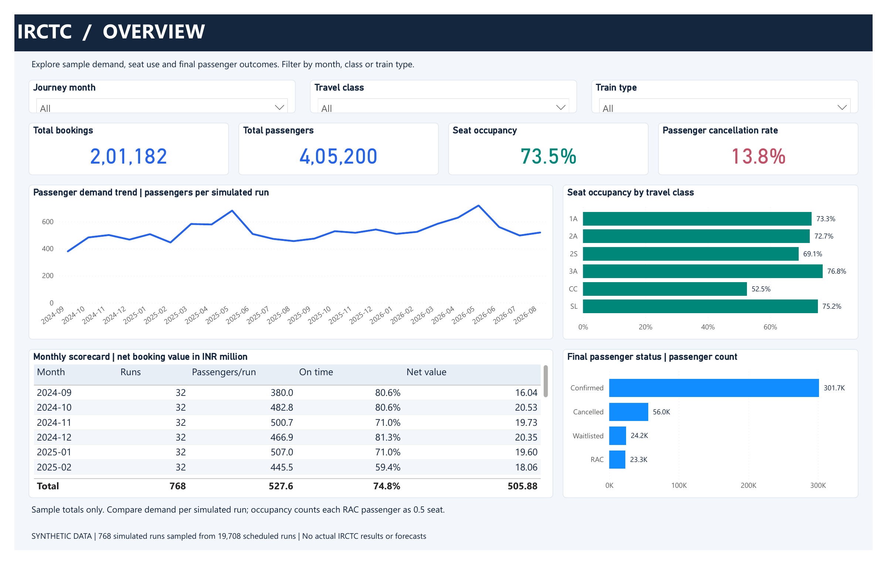

# IRCTC Analytics Portfolio

An independent data-analysis portfolio covering passenger demand, booking value, cancellations, capacity and punctuality across Excel/Google Sheets, PostgreSQL, Python and Power BI.

**All project data is synthetic.** The sample contains **768 simulated runs sampled from 19,708 scheduled runs**. These are not actual IRCTC or Indian Railways business results, network-wide estimates or forecasts. This project is not affiliated with either organization.

## Explore the report

- [Six-page screenshot gallery](power_bi/screenshots/README.md)
- [Original Power BI PDF export](power_bi/screenshots/IRCTC_Portfolio.pdf)
- [Open and refresh the editable Power BI project](power_bi/README.md)
- [Power BI milestone and verification evidence](docs/phase6_powerbi.md)

The dashboard covers an executive overview, demand and capacity, booking value, train/route comparisons, waitlist/cancellation outcomes and KPI reconciliation. It includes a season-by-class occupancy heatmap, train scatter plot, refund breakdown, ranked comparisons and final-status composition.

## Milestones and evidence

| Milestone | Current evidence | Remaining work |
|---|---|---|
| Excel / Google Sheets | Earlier milestone published | See the existing setup instructions for reproduction |
| PostgreSQL | Milestone published at `a6914b8` | No new SQL execution is claimed by this release |
| Python analytics | Published at `237dd83`; Windows execution subsequently reported 31 tests passing, 111/111 validation checks, 31/31 KPI checks and 960/960 monthly checks | Later regenerated outputs have local differences and are not bundled into the Power BI release |
| Power BI | Six populated Desktop pages and authentic PDF/PNG exports; 31 reconciled KPIs and all 11 table row-count statuses shown as PASS; screenshots published at `b287162` | Final refresh, interaction, save/reopen and fresh-clone checks need explicit verification records |
| Tableau | Local build instructions, calculated-field files and wireframes exist | Workbook creation, Desktop validation and publication are not established |

The current editable Power BI deliverable is `power_bi/portfolio_dashboard/IRCTC_Portfolio.pbip`. Earlier generated report copies are not the supported entry point. The release preparation process does not stage those old copies or unrelated Python/Tableau work.

## What the analysis demonstrates

- Consistent KPI definitions across tools, with reference comparisons rather than hardcoded dashboard totals.
- A star-schema reporting model with dimensions and separate booking, passenger, class-run, train-run and cancellation facts.
- Demand comparisons per simulated run, alongside capacity and cancellation metrics.
- A DAX validation page distinguishing calculated KPI checks from imported reference-check results.
- Explicit separation between model calculations, automated source checks and application-level verification.

Python analytics analysed **654,660 rows**, produced **16 charts** and executed five notebooks in the previously reported Windows test run. The full suite does not need rerunning solely because report formatting changed.

## KPI interpretation

| Metric | Definition / caveat |
|---|---|
| Seat occupancy | `(confirmed passengers + 0.5 × RAC passengers) / seat supply`; the RAC weighting is a simulation assumption |
| Passenger cancellation rate | Cancelled passengers / all passengers; distinct from booking cancellation rate |
| Waitlist clearance | Initially waitlisted passengers finishing Confirmed or RAC / initial waitlist demand |
| On-time performance | Runs with arrival delay ≤15 minutes / runs with recorded delay; missing delays excluded |
| Booking value | Gross simulated booking value minus refunds gives net booking value; neither revenue nor profit |
| Financial display units | INR million in the portfolio visuals; raw INR remains in reconciliation calculations |
| Class filters | Train-run measures have no class grain; do not interpret unchanged run/punctuality measures as a failed class slicer |

All sample patterns depend on the simulation design. Ratios use their defined numerator and denominator; percentages are not summed or averaged indiscriminately. No forecasting is part of this dashboard release.

## Repository guide

- `excel/`, `google_sheets/`: previously published spreadsheet deliverables.
- `sql/`: PostgreSQL modelling, analytical queries and validation.
- `python/src/analytics/`, `python/notebooks/`, `visuals/phase5_python/`: published Python analytics.
- `power_bi/portfolio_dashboard/`: current report and semantic-model source.
- `power_bi/data/`: the CSV inputs referenced by that model.
- `power_bi/screenshots/`: actual exported report images and PDF.
- `docs/phase6_powerbi.md`: evidence, scope and outstanding Power BI checks.

Power BI caches, local settings, backups and credentials are excluded. Opening a clone requires setting the `DataFolder` parameter to that clone's `power_bi/data` folder and refreshing; the saved model currently uses an absolute Windows path. See the Power BI setup guide before opening on another computer.

The screenshot export proves the appearance of the visible report pages. It does not prove every measure, filter interaction or reproducibility on a fresh machine. Tableau, synced slicers, drill-through and report-page tooltips are not claimed complete.
