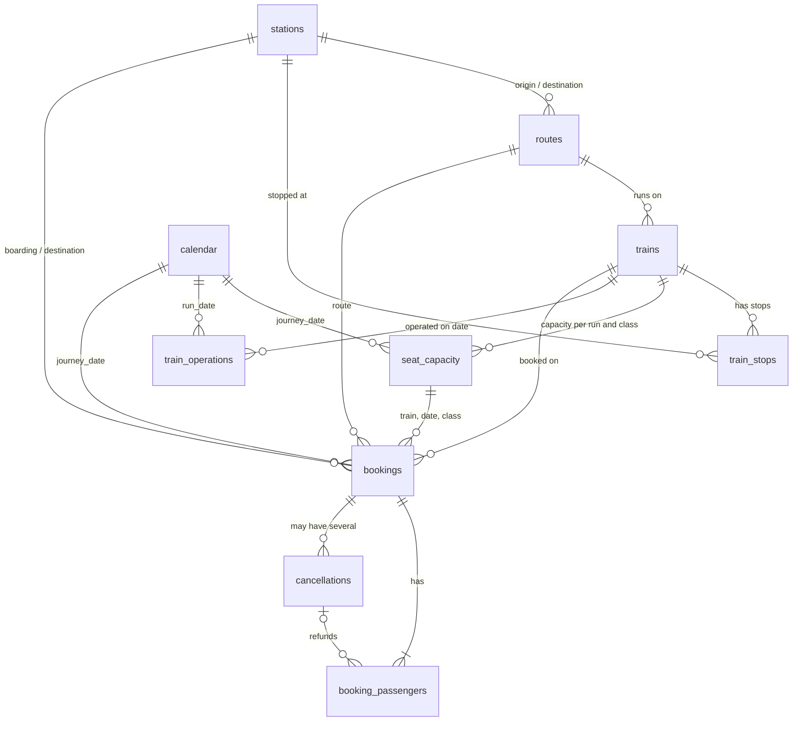

# Data Dictionary

**Status:** implemented. This describes the cleaned tables generated in Phase 2 (`data/processed/cleaned/`). Phase 4 will create the same structure in PostgreSQL. Changes made since the Phase 1 design (passenger-level status, event-level cancellations, capacity quotas) are recorded in [assumptions.md](assumptions.md).

**Data origin.** Every table has a `data_origin` column. In Phase 2 every row is `SYNTHETIC` (the allowed values `PUBLIC`, `SYNTHETIC`, `DERIVED` are kept for later layers). Nothing here represents actual IRCTC transactions.

**Naming.** Tables are lower-case snake_case (`Train_Stops` becomes `train_stops`).

---

## 1. Core concepts: booking, passenger, seat, status

| Concept | What it is | Where it lives | Counted by |
|---|---|---|---|
| **Booking** | One reservation transaction for one train run and one travel class, carrying 1 to 6 passengers | `bookings` (one row per booking) | Total Bookings, Confirmed / Cancelled Booking Count |
| **Passenger** | One traveller slot on a booking. Anonymised: only an age band and a fare. **Status is tracked here** | `booking_passengers` (one row per passenger) | Total Passengers, occupancy, waiting-list demand |
| **Seat** | One unit of capacity for a train run and class | `seat_capacity.total_seats` (a count, not one row per seat) | Available Seats, Occupancy |
| **Cancellation event** | One refund event: a passenger cancelling, or the system refunding an uncleared waiting list. Covers 1 or more passengers of one booking | `cancellations` | Refund Amount, Cancellation Rate |

A booking is **not** a passenger, and a passenger is **not** a seat. Passengers on one booking can have different statuses (for example two Confirmed and one Waitlisted), and one booking can have several cancellation events.

### Passenger status

| Status | Meaning | Travels? | Seat-equivalents (occupancy) |
|---|---|---|---|
| Confirmed | Holds a confirmed seat or berth | Yes | 1 per passenger |
| RAC | Reservation Against Cancellation: holds a shared berth | Yes | 0.5 per passenger (configurable simulation assumption `RAC_SEAT_WEIGHT`, A-09) |
| Waitlisted | Not confirmed by chart preparation; does not travel; refunded automatically by a `System` event | No | 0 |
| Cancelled | Cancelled by the passenger before chart preparation; refunded through a `Passenger` event | No | 0 |

- `initial_status` is the status at booking time (Confirmed, RAC or Waitlisted). `final_status` is the status at chart preparation. A waitlisted passenger can end Confirmed, RAC, Waitlisted or Cancelled; statuses are never demoted (BR-17).
- `bookings.booking_status` is a **derived roll-up** of the passengers' final statuses: the shared status if they all agree, otherwise `Mixed` (BR-02).

---

## 2. Tables at a glance

| # | Table | Grain (one row per...) | Primary key |
|---|---|---|---|
| 1 | `trains` | train (a scheduled service) | `train_id` |
| 2 | `stations` | station | `station_id` |
| 3 | `routes` | directional origin-destination station pair | `route_id` |
| 4 | `train_stops` | stop of a train, in order | (`train_id`, `stop_sequence`) |
| 5 | `bookings` | booking (reservation transaction) | `booking_id` |
| 6 | `booking_passengers` | passenger on a booking | `passenger_id` |
| 7 | `cancellations` | cancellation or refund event | `cancellation_id` |
| 8 | `seat_capacity` | simulated train run x travel class | `capacity_id` |
| 9 | `train_operations` | simulated train run (train x run date) | `operation_id` |
| 10 | `calendar` | calendar date | `calendar_date` |

A **train run** is one scheduled operation of a train on one date. Only a **sample** of scheduled runs is simulated (A-16): `train_operations` and `seat_capacity` hold exactly the simulated runs.

---

## 3. Table definitions

Types are PostgreSQL types. "Req" means `NOT NULL`. Every table also carries `data_origin VARCHAR(10) NOT NULL CHECK (data_origin IN ('PUBLIC','SYNTHETIC','DERIVED'))`, which is not repeated in each table below.

### 3.1 `stations`

**Grain:** one row per station. **PK:** `station_id`. 32 rows.

| Column | Type | Req | Constraints | Description |
|---|---|---|---|---|
| station_id | INTEGER | Yes | PK | Surrogate key |
| station_code | VARCHAR(8) | Yes | UNIQUE; stored upper-case and trimmed | Synthetic three-letter code |
| station_name | VARCHAR(80) | Yes | | Generic name `<City> Central` (A-14) |
| city | VARCHAR(60) | Yes | | City label |
| state | VARCHAR(60) | Yes | | State or union territory label |
| region | VARCHAR(12) | Yes | CHECK in North, South, East, West, Central, Northeast | Broad region label |

### 3.2 `routes`

**Grain:** one row per directional origin-destination pair (A to B and B to A are different routes). Several trains can share a route. **PK:** `route_id`. 40 rows.

| Column | Type | Req | Constraints | Description |
|---|---|---|---|---|
| route_id | INTEGER | Yes | PK | Surrogate key |
| origin_station_id | INTEGER | Yes | FK to stations | Origin |
| destination_station_id | INTEGER | Yes | FK to stations; CHECK differs from origin | Destination |
| route_name | VARCHAR(120) | Yes | | Display name, for example "City A to City B" |
| distance_km | NUMERIC(7,1) | Yes | CHECK > 0 | Illustrative end-to-end distance: great-circle distance x 1.25 |

Unique: (`origin_station_id`, `destination_station_id`).

### 3.3 `trains`

**Grain:** one row per train service. **PK:** `train_id`. 52 rows.

| Column | Type | Req | Constraints | Description |
|---|---|---|---|---|
| train_id | INTEGER | Yes | PK | Surrogate key |
| train_number | VARCHAR(10) | Yes | UNIQUE | Fictional number such as `S1001` |
| train_name | VARCHAR(80) | Yes | | Fictional service name |
| train_type | VARCHAR(12) | Yes | CHECK in Superfast, Express, Premium | Service category |
| route_id | INTEGER | Yes | FK to routes | The end-to-end route the train serves |
| run_days | CHAR(7) | Yes | CHECK matches `^[YN]{7}$` and contains at least one `Y` | Scheduled days of operation, Monday to Sunday |

### 3.4 `train_stops`

**Grain:** one row per train per stop. **PK:** (`train_id`, `stop_sequence`).

| Column | Type | Req | Constraints | Description |
|---|---|---|---|---|
| train_id | INTEGER | Yes | FK to trains | |
| stop_sequence | SMALLINT | Yes | CHECK >= 1 | 1 = origin |
| station_id | INTEGER | Yes | FK to stations | |
| arrival_time | TIME | No | NULL only at the first stop | Scheduled arrival |
| departure_time | TIME | No | NULL only at the last stop | Scheduled departure. The first stop's departure time defines the train's departure for chart preparation |
| day_offset | SMALLINT | Yes | CHECK >= 0 | Days after the origin departure day |
| distance_from_origin_km | NUMERIC(7,1) | Yes | CHECK >= 0 | Cumulative distance |

Unique: (`train_id`, `station_id`).

### 3.5 `calendar`

**Grain:** one row per date, 2024-05-01 to 2026-12-31 (975 rows). **PK:** `calendar_date`. Holiday and peak flags are **modelled**, not an official list (A-15).

| Column | Type | Req | Constraints | Description |
|---|---|---|---|---|
| calendar_date | DATE | Yes | PK | |
| year | SMALLINT | Yes | | Calendar year |
| quarter | SMALLINT | Yes | CHECK 1 to 4 | Calendar quarter |
| month_number | SMALLINT | Yes | CHECK 1 to 12 | |
| month_name | VARCHAR(9) | Yes | | |
| week_of_year | SMALLINT | Yes | CHECK 1 to 53 | ISO week |
| day_of_month | SMALLINT | Yes | CHECK 1 to 31 | |
| day_of_week_number | SMALLINT | Yes | CHECK 1 to 7 | ISO: Monday = 1 |
| day_name | VARCHAR(9) | Yes | | |
| is_weekend | BOOLEAN | Yes | | Saturday or Sunday |
| season | VARCHAR(12) | Yes | CHECK in Winter, Summer, Monsoon, Post-Monsoon | Project convention: Winter Dec to Feb, Summer Mar to May, Monsoon Jun to Sep, Post-Monsoon Oct to Nov |
| fiscal_year | SMALLINT | Yes | | April to March year, labelled by the ending year |
| is_holiday | BOOLEAN | Yes | | One of four fixed-date holidays in the modelled list (Jan 26, Aug 15, Oct 2, Dec 25) |
| holiday_name | VARCHAR(60) | No | NOT NULL when `is_holiday` | |
| is_peak_travel_period | BOOLEAN | Yes | | Inside a modelled vacation, festival or year-end window |
| peak_period_name | VARCHAR(60) | No | NOT NULL when `is_peak_travel_period` | Ends with "(modelled)" |

### 3.6 `seat_capacity`

**Grain:** one row per simulated train run and travel class. **PK:** `capacity_id`. Capacity is **simulated** (A-12). 2,285 rows.

| Column | Type | Req | Constraints | Description |
|---|---|---|---|---|
| capacity_id | BIGINT | Yes | PK | |
| train_id | INTEGER | Yes | FK to trains | |
| journey_date | DATE | Yes | FK to calendar | |
| travel_class | CHAR(2) | Yes | CHECK in SL, 3A, 2A, 1A, CC, 2S | Travel class |
| coaches_attached | SMALLINT | Yes | CHECK > 0 | Simulated coaches for that class |
| seats_per_coach | SMALLINT | Yes | CHECK > 0 | Real seats per coach for the class (1A 24, 2A 46, 3A 64, SL 72, CC 78, 2S 108) |
| total_seats | INTEGER | Yes | CHECK > 0 | Must equal `coaches_attached` x `seats_per_coach` (BR-09) |
| rac_berths | SMALLINT | Yes | CHECK >= 0 | Berths reserved for RAC; each holds 2 RAC passengers. 0 for classes without RAC (A-09) |
| wl_limit | INTEGER | Yes | CHECK >= 0 | Maximum waitlisted passengers (A-08) |

Unique: (`train_id`, `journey_date`, `travel_class`). Confirmed passengers can use at most `total_seats - rac_berths` seats.

### 3.7 `train_operations`

**Grain:** one row per simulated train run (train x run date). **PK:** `operation_id`. Delays are **simulated**. 768 rows.

| Column | Type | Req | Constraints | Description |
|---|---|---|---|---|
| operation_id | BIGINT | Yes | PK | |
| train_id | INTEGER | Yes | FK to trains | |
| run_date | DATE | Yes | FK to calendar | Origin departure date of the run |
| departure_delay_min | INTEGER | Yes | CHECK between -60 and 1440 | Minutes late leaving the origin; negative means early |
| arrival_delay_min | INTEGER | No | CHECK between -60 and 1440 when present | Minutes late at the destination; negative means early. **NULL where the source value was missing or out of range**; NULL runs are excluded from delay KPIs, never imputed |

Unique: (`train_id`, `run_date`). The range in the CHECK is a sanity bound for validation, not a physical limit.

### 3.8 `bookings`

**Grain:** one row per booking. **PK:** `booking_id`. Every booking is for a single train run and a single class, and is end to end (A-06).

| Column | Type | Req | Constraints | Description |
|---|---|---|---|---|
| booking_id | BIGINT | Yes | PK | Starts at 1,000,001 |
| booking_reference | VARCHAR(12) | Yes | UNIQUE | Synthetic reference, not a real PNR |
| train_id | INTEGER | Yes | FK to trains | |
| journey_date | DATE | Yes | FK to calendar | Date of travel (origin departure) |
| route_id | INTEGER | Yes | FK to routes | |
| boarding_station_id | INTEGER | Yes | FK to stations | The train's origin |
| destination_station_id | INTEGER | Yes | FK to stations | The train's terminus |
| travel_class | CHAR(2) | Yes | CHECK in SL, 3A, 2A, 1A, CC, 2S | |
| booking_ts | TIMESTAMP | Yes | | When the booking was made (IST) |
| num_passengers | SMALLINT | Yes | CHECK between 1 and 6 | Passengers on the booking |
| booking_status | VARCHAR(10) | Yes | CHECK in Confirmed, RAC, Waitlisted, Cancelled, Mixed | **Derived** roll-up of passenger `final_status` (BR-02) |
| total_fare | NUMERIC(12,2) | Yes | CHECK > 0 | Gross fare for all passengers, INR, before any refund (A-03) |

Composite FK: (`train_id`, `journey_date`, `travel_class`) references `seat_capacity`, so every booking points at an existing capacity record.

### 3.9 `booking_passengers`

**Grain:** one row per passenger on a booking. **PK:** `passenger_id`. No names, contact details or ID numbers are stored.

| Column | Type | Req | Constraints | Description |
|---|---|---|---|---|
| passenger_id | BIGINT | Yes | PK | |
| booking_id | BIGINT | Yes | FK to bookings | |
| passenger_seq | SMALLINT | Yes | CHECK between 1 and 6 | Position on the booking |
| age_band | VARCHAR(7) | Yes | CHECK in Child, Adult, Senior, Unknown | `Unknown` where the source value was missing (retained, not imputed) |
| fare_amount | NUMERIC(10,2) | Yes | CHECK > 0 | This passenger's fare, INR |
| initial_status | VARCHAR(10) | Yes | CHECK in Confirmed, RAC, Waitlisted | Status at booking time |
| final_status | VARCHAR(10) | Yes | CHECK in Confirmed, RAC, Waitlisted, Cancelled | Status at chart preparation |
| cancellation_id | BIGINT | No | FK to cancellations | The event that refunded this passenger. NULL for Confirmed and RAC passengers (BR-10) |

Unique: (`booking_id`, `passenger_seq`).

### 3.10 `cancellations`

**Grain:** one row per cancellation or refund event. A booking can have several (partial cancellations, plus a system refund). **PK:** `cancellation_id`. The table holds both passenger cancellations and system auto-refunds of uncleared waitlisted passengers (A-19).

| Column | Type | Req | Constraints | Description |
|---|---|---|---|---|
| cancellation_id | BIGINT | Yes | PK | |
| booking_id | BIGINT | Yes | FK to bookings | Not unique: a booking may have several events |
| cancellation_ts | TIMESTAMP | Yes | | When the event occurred (IST) |
| cancellation_type | VARCHAR(9) | Yes | CHECK in Passenger, System | `Passenger` = cancelled by the passenger; `System` = auto-refund of an uncleared waitlist |
| status_at_cancellation | VARCHAR(10) | Yes | CHECK in Confirmed, RAC, Waitlisted | Status of the covered passengers just before the event (one status per event; `Waitlisted` for every System event) |
| cancelled_passengers | SMALLINT | Yes | CHECK between 1 and 6 | Number of passengers covered; equals the number of passengers linked to the event |
| original_fare_amount | NUMERIC(12,2) | Yes | CHECK > 0 | Sum of the covered passengers' fares |
| cancellation_charge | NUMERIC(10,2) | Yes | CHECK >= 0 | Amount retained (illustrative rule, A-10) |
| refund_amount | NUMERIC(12,2) | Yes | CHECK >= 0 | `original_fare_amount - cancellation_charge`; not assumed to equal the fare |

---

## 4. Business rules

Each rule is implemented as one or more automated checks in `python/src/validate_data.py` (check IDs such as `BR-03a`, `BR-03b` are parts of one rule). Phase 8 re-runs them in the full test suite.

| ID | Rule |
|---|---|
| BR-01 | Passenger `initial_status` is one of Confirmed, RAC, Waitlisted; `final_status` is one of Confirmed, RAC, Waitlisted, Cancelled |
| BR-02 | `bookings.booking_status` equals the roll-up of that booking's passenger `final_status` values: the shared status, or `Mixed` if they differ |
| BR-03 | `num_passengers` equals the count of the booking's passenger rows; `total_fare` equals the sum of their `fare_amount`; `passenger_seq` runs 1 to n |
| BR-04 | Booking date is on or before `journey_date`; lead time is 0 to `max_advance_days`; `booking_ts` is before chart preparation (4 hours before the first stop's departure); `journey_date` is inside the approved window |
| BR-05 | `journey_date` falls on one of the train's `run_days` and has a matching `train_operations` row (also for `seat_capacity` rows) |
| BR-06 | The booking's route equals the train's route, and boarding and destination stations equal the route's origin and destination and differ from each other (end to end) |
| BR-07 | A `seat_capacity` row exists for every booking's train, date and class |
| BR-08 | For each train-class run: Confirmed passengers <= `total_seats - rac_berths`; RAC passengers <= 2 x `rac_berths`; Confirmed + `rac_seat_weight` x RAC <= `total_seats`; Waitlisted passengers <= `wl_limit` |
| BR-09 | `total_seats` = `coaches_attached` x `seats_per_coach`, and `seats_per_coach` equals the class standard |
| BR-10 | A passenger has a `cancellation_id` exactly when `final_status` is Cancelled or Waitlisted; `Passenger` events link Cancelled passengers and `System` events link Waitlisted passengers, all from the event's own booking |
| BR-11 | For every cancellation event: `cancelled_passengers` = number of linked passengers (at least 1); `original_fare_amount` = sum of their fares; `refund_amount` + `cancellation_charge` = `original_fare_amount`; amounts not negative; `status_at_cancellation` is Waitlisted for every `System` event |
| BR-12 | `booking_ts` <= `cancellation_ts` <= chart preparation time |
| BR-13 | Train stops are numbered without gaps from 1; the first stop is the route origin and the last is the route destination; `distance_from_origin_km` strictly increases |
| BR-14 | No names, phone numbers, emails, payment details or real PNRs appear anywhere in the data |
| BR-15 | Fares are positive and refunds and charges are never negative; `num_passengers` is between 1 and 6 |
| BR-16 | `station_code` is unique, upper-case and trimmed |
| BR-17 | A passenger's status is never demoted: Confirmed can only stay Confirmed or become Cancelled; RAC can become Confirmed or Cancelled; Waitlisted can become RAC, Confirmed or Cancelled |

---

## 5. Raw and cleaned layers

- **Truth (internal):** the clean, internally consistent synthetic dataset, written to `data/interim/synthetic_truth/` (git-ignored). It exists so cleaning can be verified against known correct values.
- **Raw layer** (`data/raw/synthetic/`): the same ten tables with every column held as **text** and with **controlled quality issues** injected into the transactional and operational tables (missing values, duplicates, invalid dates, invalid statuses, inconsistent station codes, invalid fares, orphan rows, inconsistent capacity, invalid delays). In the raw `bookings` file, stations arrive as `boarding_station_code` and `destination_station_code` text codes, which cleaning maps to `station_id`. Raw files are preserved and never edited.
- **Cleaned layer** (`data/processed/cleaned/`): the tables above with all constraints enforced and typed columns. Records that cannot be repaired without inventing data are rejected together with their whole booking family (booking, passengers, cancellation events).
- **Sample** (`data/sample/`): every record of 20 simulated train runs plus all reference tables, small enough to keep in Git.
- **Derived layer** (`data/processed/derived/`, Phase 3): aggregates of the cleaned synthetic data, every row labelled `data_origin = DERIVED`: `monthly_kpis.csv` (24 months), `monthly_class_occupancy.csv` (month x class), `occupancy_class_runs.csv` (2,285 train-class runs), `train_runs.csv` (768 runs), `cancellation_by_lead_and_class.csv`, `route_summary.csv`, `refund_events_summary.csv`. Forecasts, when produced in Phase 5, will be labelled `DERIVED` and as forecasts.
- **Excel sample** (`data/sample/excel/`): a balanced, run-complete analytical sample of 48 simulated runs (balanced by journey month only; no Premium train runs and no 1A class-runs) with every booking, passenger, cancellation, capacity and operations row of those runs.

The 30 issue types, affected record counts, cleaning rules and outcomes are in [data_quality_report.md](data_quality_report.md), and the origin and generation method of every dataset is in [data_sources.md](data_sources.md).
