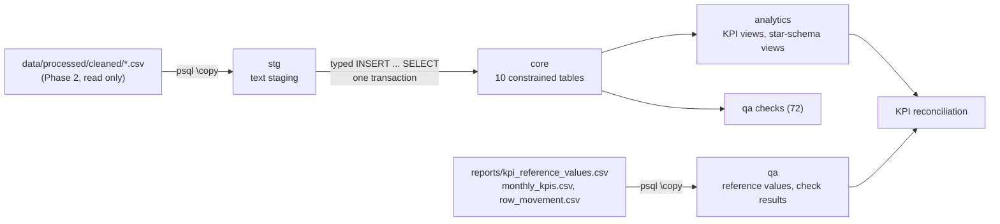
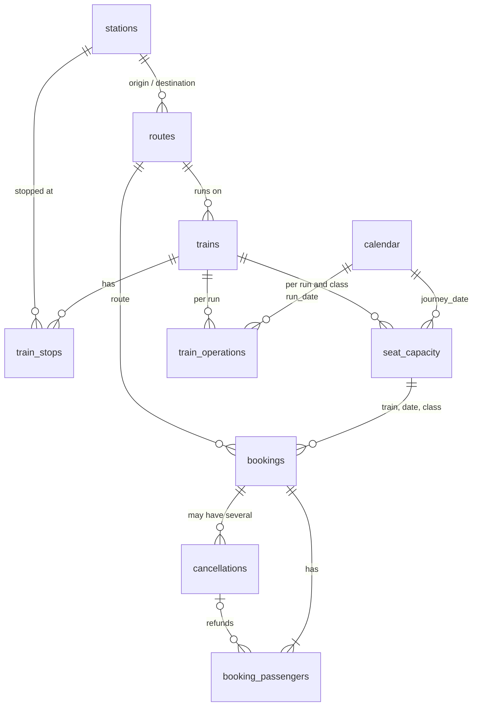

# Phase 4: PostgreSQL Implementation

> **All data is synthetic.** It comes from a **sampled simulation**: 768 simulated train runs over 24 months, compared with 19,708 scheduled runs in the modelled schedule (3.9%). It is not IRCTC or Indian Railways data, and not a representative full railway schedule. Monthly totals reflect the sampling design, so compare months with per-run and capacity-normalised measures. **No forecasts** are produced anywhere in this layer (the project's only forecast is the optional synthetic backtest appendix in Phase 8, `reports/forecast_appendix.md`). KPI definitions are the approved ones in [KPI_definitions.md](KPI_definitions.md) and were not changed to make anything reconcile.

## 1. Environment and verification status

| Item | Value |
|---|---|
| Target environment (yours) | Windows, PostgreSQL 18.4, `psql` 18.4, service `postgresql-x64-18`, database `irctc_analytics` (already created) |
| Where this was built and tested | PostgreSQL **16.15** on Ubuntu Linux (the only server available to the build environment) |
| **Not verified** | **The scripts have not been run on PostgreSQL 18.4 or on Windows by the author.** They use only features available in PostgreSQL 15 and later (the one version-sensitive statement is `MERGE`, in the DDL/DML examples, PostgreSQL 15+), standard `psql` meta-commands and forward-slash relative paths. `sql/run_all.ps1` was reviewed and statically checked but could not be executed (no PowerShell in the build environment) |
| How to verify on your machine | Run `sql\run_all.ps1`, then `python python\tests\test_phase4_postgres.py` (section 11). If anything fails on 18.4, the failing statement and message are printed; see section 12 |

## 2. Architecture



| Schema | Purpose |
|---|---|
| `stg` | The cleaned CSV files exactly as delivered, every column `TEXT`. Loading cannot fail on typing; typing and constraint enforcement happen on the move to `core` |
| `core` | The 10 tables of [data_dictionary.md](data_dictionary.md) with primary keys, foreign keys, NOT NULL, UNIQUE and CHECK constraints |
| `analytics` | KPI parameters (`rac_seat_weight` 0.5, `on_time_threshold_min` 15, ...), analytical views (`v_booking`, `v_passenger`, `v_class_run`, `v_run`, `v_monthly_kpis`, `v_kpi_overall`, long-format views) and star-schema views (`dim_*`, `fact_*`) |
| `qa` | Reference values copied from the Phase 2 and Phase 3 CSV files, the data-quality checks (`v_check_results`, stored in `check_results`) and the KPI reconciliation views |
| `sandbox` | Created and dropped by the DDL/DML examples only; never exists after a build |

The original files in `data/raw/synthetic/` and `data/processed/cleaned/` are **only read**. A SHA-256 manifest (`reports/phase3_data_manifest.json`) is re-checked by the tests.

## 3. How to build it (reproducible from scripts)

Prerequisites: PostgreSQL with the empty database `irctc_analytics`, `psql` available, and the cleaned CSV files present (`python python/src/pipeline.py` regenerates them; they are not stored in Git). The role needs permission to create schemas in the database (the `postgres` superuser is fine).

**Windows (PowerShell), from the project root:**

```powershell
$env:PGPASSWORD = "your-password"        # or let psql prompt
powershell -ExecutionPolicy Bypass -File sql\run_all.ps1                 # asks you to type YES
powershell -ExecutionPolicy Bypass -File sql\run_all.ps1 -Force          # no prompt
powershell -ExecutionPolicy Bypass -File sql\run_all.ps1 -User postgres -PgHost localhost -Port 5432 -Database irctc_analytics
```

The script finds `psql.exe` (PATH, then `C:\Program Files\PostgreSQL\<version>\bin`), checks that the service `postgresql-x64-18` is running, checks that the CSV files exist, asks for confirmation (the build **drops and recreates** `stg`, `core`, `analytics`, `qa` and `sandbox`), sets UTF-8 client encoding, and runs `sql/00_build_all.sql`.

**Linux / macOS / WSL / Git Bash:** `sql/run_all.sh --yes` (connection from the usual `PG*` variables).

**Directly with psql** (from the project root, because the `\copy` paths are relative to it):

```
psql -X -v ON_ERROR_STOP=1 -d irctc_analytics -f sql/00_build_all.sql
```

A build takes about 45 seconds on a single-CPU Linux machine. It stops at the first error (`ON_ERROR_STOP`); the load into `core` is one transaction, so nothing partial is left behind. The master script refuses to run if the connected database is not `irctc_analytics` (override with `-v expected_db=name`).

Analytical SQL: `sql\run_analysis.ps1` or `sql/run_analysis.sh` (all files, or one file by name).

## 4. Files

```
sql/
  00_build_all.sql              master script (psql \ir includes, in dependency order)
  run_all.ps1 / run_all.sh      safe runners (Windows PowerShell / Linux, macOS)
  run_analysis.ps1 / .sh        run the analytical queries
  schema/      01_schemas  02_core_tables  03_indexes  04_staging_tables  05_qa_tables
  transformations/  01_load_staging  02_load_core  03_post_load  04_analytics_views  05_star_schema_views  06_load_reference
  validation/  01_data_quality_checks  02_kpi_reconciliation  03_run_validation
  analysis/    01_joins  02_group_by_having  03_case_subqueries  04_ctes  05_window_functions
               06_business_kpi_queries  07_ddl_dml_examples  08_explain_examples
python/tests/test_phase4_postgres.py   the tests
reports/phase4_postgresql_validation.txt, phase4_check_results.csv, phase4_kpi_reconciliation.csv
```

Build order: schemas, core tables, staging and qa tables, staging load, core load, **indexes after the load** (faster), `ANALYZE`, views, reference load, checks, reconciliation.

## 5. Core model



| Table | Rows loaded | Grain | Primary key |
|---|---:|---|---|
| `core.stations` | 32 | station | `station_id` |
| `core.routes` | 40 | directional route | `route_id` |
| `core.trains` | 52 | train | `train_id` |
| `core.train_stops` | 203 | stop of a train | (`train_id`, `stop_sequence`) |
| `core.calendar` | 975 | date | `calendar_date` |
| `core.seat_capacity` | 2,285 | simulated train-class run | `capacity_id` |
| `core.train_operations` | 768 | simulated train run | `operation_id` |
| `core.bookings` | 201,182 | booking | `booking_id` |
| `core.booking_passengers` | 405,200 | passenger on a booking | `passenger_id` |
| `core.cancellations` | 43,923 | refund event (Passenger or System) | `cancellation_id` |

Totals: **10 primary keys, 18 foreign keys, 8 UNIQUE constraints, 55 CHECK constraints**; only six columns are nullable (`arrival_time`, `departure_time`, `holiday_name`, `peak_period_name`, `arrival_delay_min`, `cancellation_id`). Every constraint has a name (`pk_`, `fk_`, `uq_`, `ck_` prefixes) so an error message identifies the rule.

**Business rules.** Row-level rules are CHECK constraints (for example BR-10a `ck_booking_passengers_link`, BR-17 `ck_booking_passengers_transition`, BR-11c `ck_cancellations_arithmetic`, BR-09 `ck_seat_capacity_total` and `ck_seat_capacity_spc`, BR-07 as the composite foreign key `fk_bookings_capacity`). Rules that span rows (BR-02, BR-03, BR-04b, BR-05, BR-06, BR-08, BR-10b/c, BR-11a/b/e, BR-12, BR-13) cannot be CHECK constraints; they are verified by `qa.v_check_results` after every build (section 8). They were not implemented as triggers because they are dataset invariants checked once after a bulk load.

**Indexes.** Primary-key and UNIQUE constraints create 18 indexes automatically. The 13 secondary indexes are created after the load:

| Index | Supports |
|---|---|
| `ix_routes_destination`, `ix_trains_route`, `ix_train_stops_station`, `ix_seat_capacity_date`, `ix_train_operations_date` | Foreign-key joins and date filters on the small tables |
| `ix_bookings_run_class` (`train_id`, `journey_date`, `travel_class`) | The composite foreign key to `seat_capacity` and per-run lookups |
| `ix_bookings_journey_date`, `ix_bookings_route`, `ix_bookings_status` | Monthly, route and status analysis |
| `ix_bp_status_pair` (`initial_status`, `final_status`) | Waiting-list and cancellation analysis |
| `ix_bp_cancellation` (partial, `WHERE cancellation_id IS NOT NULL`) | The refund link; the partial index is smaller because 66% of passengers have no event |
| `ix_cancellations_booking`, `ix_cancellations_type_ts` | Joins to bookings, refund analysis by type and time |

`sql/analysis/08_explain_examples.sql` shows the plans (`EXPLAIN (ANALYZE, BUFFERS)`), and a test checks that selective lookups use these indexes. Boarding and destination station columns are not indexed: they equal the route's origin and destination and are never filtered alone.

## 6. Data loading

`01_load_staging.sql` copies the 10 cleaned CSV files with `\copy` (client-side, UTF-8). `02_load_core.sql` inserts into `core` in dependency order (stations, routes, trains, train stops, calendar, capacity, operations, bookings, **cancellations before passengers**) inside one transaction with explicit casts. The en dash in train names loads correctly because the client encoding is UTF-8 (`\encoding UTF8`, `PGCLIENTENCODING`); the database may be UTF-8 or WIN1252. Row counts must equal the CSV rows and Phase 2's `row_movement.csv`; the checks enforce it.

## 7. KPI layer (approved definitions, unchanged)

| KPI (docs/KPI_definitions.md) | Views and queries | Denominator |
|---|---|---|
| 1 Total Bookings, 2 Total Passengers | `v_kpi_overall`, query `K1`, `K2` | n/a |
| 3 Confirmed Booking Count (every passenger Confirmed; Mixed separate), 4 Cancelled Booking Count | `K3`, `K4` | n/a |
| 5 Cancellation Rate (passenger-based) + booking-based companion | `K5` | Total passengers (companion: total bookings) |
| 6 Gross, 7 Refund (Passenger / System / charges), 8 Net | `K6`, `K7`, `K8` | n/a |
| 9 Average Fare | `K9` | Total passengers (secondary: bookings) |
| 10 Seat Occupancy % (Confirmed + 0.5 x RAC; waitlist pressure separate) | `v_class_run`, `K10` | Available seats, same train-class runs |
| 11 Waiting-List Demand (initial status), clearance rate, uncleared | `K11`, `T1` | Initially waitlisted passengers |
| 12 On-Time Performance %, 13 Average Delay | `v_run`, `K12`, `K13` | Runs with a recorded arrival delay |
| 14 Monthly Booking Growth (+ per-run growth) | `v_monthly_kpis` (LAG), `K14`, `W4` | Previous month's bookings |
| 15 Route-Level Demand | `K15`, `W3` | n/a (simulated runs shown) |

The RAC weight (0.5) and the on-time threshold (15 minutes) live in `analytics.kpi_parameter` as configurable simulation assumptions; changing them changes the KPIs (a test proves it). Ratios return `NULL`, not 0, when the denominator is 0.

**Reconciliation** (`sql/validation/02_kpi_reconciliation.sql`): `analytics.v_kpi_overall_long` is compared with `reports/kpi_reference_values.csv` (31 KPIs), and `analytics.v_monthly_kpis_long` with `data/processed/derived/monthly_kpis.csv` (24 months x 40 columns = 960 comparisons). Tolerances follow KPI_definitions.md section 1.8: counts exact, currency 0.005, ratios 0.00005 (0.0001 for per-run and seat-equivalent values). Result of the last run: **31 of 31 and 960 of 960 within tolerance, 0 failures**. The KPI views never read the `qa` reference tables (a test checks the view definitions), and the tests prove that a deliberate error in the data, or a changed parameter, makes the reconciliation fail.

## 8. Data-quality validation

`qa.v_check_results` has 72 checks, each returning the number of violating records (0 = PASS), mirroring `python/src/validate_data.py`: structure (schemas, constraint counts, all constraints validated, nullable columns, indexes), row counts (stage vs core vs the Phase 2 cleaned counts), business rules BR-01 to BR-17, domains, `data_origin = 'SYNTHETIC'` on every row, and the size requirements (100,000 bookings, 50 trains, 30 stations, 24 months). `03_run_validation.sql` stores the result in `qa.check_results` and exports `reports/phase4_check_results.csv`. Result of the last run: **72 of 72 pass**. Thirteen deliberate corruptions are each detected by the intended check (tests).

## 9. Analytical SQL

All examples live in `sql/analysis`; each statement has a label (`-- [W2]`) so the tests and this guide can refer to it. There are 49 analytical queries, 11 DDL/DML examples and 6 `EXPLAIN` examples.

| File | Labels | Techniques |
|---|---|---|
| `01_joins.sql` | J1 to J8 | INNER, LEFT, anti-join, RIGHT, FULL OUTER, self join, CROSS JOIN, joining at the right grain |
| `02_group_by_having.sql` | G1 to G6 | GROUP BY, FILTER, HAVING (with simulated-run counts), ROLLUP, GROUPING SETS |
| `03_case_subqueries.sql` | C1 to C3, S1 to S5 | CASE (lead buckets, occupancy bands), scalar, correlated, IN, NOT EXISTS, derived-table subqueries |
| `04_ctes.sql` | T1 to T4 | Chained CTEs (waiting-list funnel), RECURSIVE CTE, data-modifying CTE (rolled back) |
| `05_window_functions.sql` | W1 to W8 | ROW_NUMBER, RANK vs DENSE_RANK (ties), LAG, LEAD, running total, moving average, NTILE, FIRST_VALUE |
| `06_business_kpi_queries.sql` | K1 to K15 | The 15 KPIs directly on the core tables, with numerator and denominator |
| `07_ddl_dml_examples.sql` | D1 to D11 | CREATE/ALTER/DROP, INSERT ... SELECT, upsert, UPDATE ... FROM, DELETE, MERGE, SAVEPOINT, TRUNCATE, CREATE VIEW, constraint rejection, in a throwaway `sandbox` schema |
| `08_explain_examples.sql` | E1 to E6 | `EXPLAIN (ANALYZE, BUFFERS)`: index scans, partial index, hash join, WindowAgg |

Results of the window and CTE queries are checked against pandas in the tests (RANK/DENSE_RANK ties, LAG growth against `monthly_kpis.csv`, recursive CTE distances, occupancy bands).

## 10. Star-schema views

For Power BI (Phase 6) and Tableau (Phase 7): dimensions `dim_date`, `dim_station`, `dim_route`, `dim_train`, `dim_travel_class`; facts `fact_passenger` (grain: passenger), `fact_booking`, `fact_class_run` (grain: simulated train-class run), `fact_train_run` (grain: simulated run) and `fact_cancellation_event`. They are views over `core`, so no data is duplicated; a test confirms that every fact key resolves to a dimension and that a star query reproduces the booking totals.

## 11. Tests

```
python python\tests\test_phase4_postgres.py        # prints the results and writes reports\phase4_postgresql_validation.txt
pytest python\tests\test_phase4_postgres.py -q
```

Needs `psql` on PATH and the `PG*` variables for your server (`PGHOST`, `PGPORT`, `PGUSER`, `PGPASSWORD`; `PGDATABASE` defaults to `irctc_analytics`); no Python database driver is required. **The first test rebuilds the five schemas of that database.** The suite checks the build and its repeatability, the schema inventory, row counts against the CSV files and Phase 2, loaded values, 19 constraint rejections, the 72 checks, 13 corruption detections, the KPI reconciliation (including deliberate errors), SQL versus pandas, every analysis file, the star schema, indexes, labels, the absence of forecasts, the runner scripts, the documentation, that the original data is unchanged, and that no approved Phase 1 to 3 deliverable was altered (compared with the Phase 3 ZIP, apart from the README, project plan, KPI matrix and report files that must reflect Phase 4).

## 12. Troubleshooting

| Symptom | Likely cause and fix |
|---|---|
| `psql.exe not found` | Add `C:\Program Files\PostgreSQL\18\bin` to PATH or pass `-PsqlPath` |
| `Service postgresql-x64-18 is not running` | `Start-Service postgresql-x64-18` in an administrator PowerShell |
| `password authentication failed` | Set `$env:PGPASSWORD`, use a `pgpass.conf`, or pass the right `-User` |
| `could not open file "data/processed/cleaned/...csv"` | `psql` was started from the wrong folder. Run from the project root (the runner does this) and make sure the files exist (`python python/src/pipeline.py`) |
| `ERROR: connected to the wrong database` | The master script only builds `irctc_analytics`. Connect with `-d irctc_analytics` |
| `permission denied for database` or `schema` | The role needs `CREATE` on the database; use `postgres` or grant it |
| `invalid byte sequence` / odd characters in train names | The client encoding is not UTF-8. The runner sets `PGCLIENTENCODING=UTF8`; with plain `psql` use `\encoding UTF8` first |
| `syntax error at or near "MERGE"` | The server is older than PostgreSQL 15; remove D7 from `07_ddl_dml_examples.sql` |
| A check fails | `SELECT * FROM qa.check_results WHERE NOT passed;` then run the matching query in `qa.v_check_results` for the offending rows |

## 13. Limitations and unresolved issues

* **Not run on PostgreSQL 18.4 or Windows** by the author (section 1). Run the build and the tests there to close this.
* `run_all.ps1` and `run_analysis.ps1` were reviewed and statically checked, not executed.
* Synthetic, sampled simulation: results describe this dataset only; per-run measures are needed for comparisons; only 9 to 20 runs exist per train.
* The cross-row business rules are verified by checks after loading, not enforced continuously (no triggers). Writing data after the build can break them; re-run `qa.v_check_results`.
* Views are not materialised. For this dataset size the largest view (`v_class_run`) takes about one second; materialise it if the data grows.
* No forecasting, no Python analysis and no BI models: the Python analysis and the BI models are Phases 5 to 7, and the project's only forecast is the optional synthetic backtest appendix in Phase 8.
