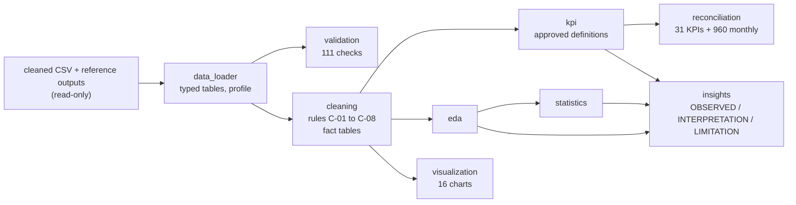

# Phase 5: Python Analytics

> **All data is synthetic.** It comes from a **sampled simulation**: 768 simulated train runs over 24 months, compared with 19,708 scheduled runs in the modelled schedule (3.9%). It is not IRCTC or Indian Railways data, and nothing here describes real passenger behaviour or the real network. **No forecasts** are produced in this phase; forecasting is not part of the core analysis, and the only forecast in the project is the optional, clearly labelled synthetic backtest appendix in Phase 8 (`reports/forecast_appendix.md`; nothing beyond the 24 simulated months). Per assumption A-20 the generator deliberately builds in seasonal and holiday demand, weekday effects, a 1% monthly demand trend, cancellation rising with lead time, and delays varying with season, distance and train type, so the analysis demonstrates **method** and can only rediscover what was built in. Associations are not causes.

## Purpose

A reproducible Python analytics layer over the FULL validated cleaned dataset: data loading, validation, a cleaning pipeline, structured EDA, statistical analysis, the approved KPIs, reconciliation against the reference values, 16 charts and a business-insights report. The 48-run Excel sample is **not** used; it remains an Excel exercise dataset only.

## Dataset sources

| Source | Rows | Role |
|---|---:|---|
| `data/processed/cleaned/*.csv` (10 tables, Phase 2) | 654,660 in total: 201,182 bookings, 405,200 passengers, 43,923 cancellation events, 2,285 simulated train-class runs, 768 simulated runs, 52 trains, 40 routes, 32 stations, 203 train stops, 975 calendar days | The only analytical data. Read-only |
| `reports/kpi_reference_values.csv` (Phase 3) | 31 KPIs | Values the Python KPIs are reconciled with |
| `data/processed/derived/monthly_kpis.csv` (Phase 3) | 24 months x 40 columns | Monthly reconciliation |
| `reports/data_quality/row_movement.csv` (Phase 2) | 10 tables | Validated cleaned row counts |
| `reports/phase4_kpi_reconciliation.csv`, `reports/phase4_check_results.csv` (Phase 4) | 31 KPIs, 72 checks | Values produced by the PostgreSQL layer on PostgreSQL 16.15 |

Date ranges: journeys 2024-09-01 to 2026-08-31 (24 months); bookings were made from 2024-05-05; the calendar table spans 2024-05-01 to 2026-12-31. Every row of every table is labelled `data_origin = SYNTHETIC`. The relationships are the 17 foreign keys of the data dictionary (checked for orphans). Types are explicit at load time (integers, floats, booleans, parsed dates and timestamps, nullable integers for `arrival_delay_min` and `cancellation_id`). Source files are **never modified**: a SHA-256, size and modification-time fingerprint is taken before and after every run (25 files: the 10 cleaned tables, the 10 raw originals they came from, and the 5 reference outputs).

## Workflow



| Module (`python/src/analytics/`) | Role |
|---|---|
| `data_loader.py` | Typed read-only loading, profiling, relationship check, source fingerprint |
| `validation.py` | 111 independent checks: row counts vs Phase 2, duplicates, missing values, dates, categories, amounts, capacity and occupancy bounds, booking/passenger and cancellation/refund reconciliation, waitlist/status consistency, train/run relationships, labelling, size |
| `cleaning.py` | The cleaning pipeline and the aggregation-ready fact tables |
| `kpi.py` | The approved KPIs, monthly KPIs, reconciliation (written independently of the Phase 3 `python/src/kpi.py`, so the reconciliation is a real check) |
| `eda.py` | Structured EDA, sections A to E, and the EDA summary |
| `statistics.py` | Descriptive statistics, intervals, tests, correlations (import it as `analytics.statistics`; the standard-library `statistics` module is unaffected) |
| `visualization.py` | The 16 Matplotlib charts |
| `insights.py` | The business-insights report |
| `run_phase5.py` | The single entry point |

The package sits beside the Phase 3 modules in `python/src/` (`kpi.py`, `config.py`, ...) and reuses `config.py` for the documented parameters (RAC weight 0.5, on-time threshold 15 minutes, 4-hour chart preparation, 120-day booking window).

## Cleaning rules

The tables were already cleaned in Phase 2 (defects repaired or rejected; see `docs/data_quality_report.md`). Phase 5 re-applies the project's rules **idempotently**, adds derived columns and builds fact tables. **No row is removed and no value is imputed**: rows in equal rows out for every table, and each rule application is logged with the rows it touched (`reports/phase5_cleaning_log.csv`).

| Rule | What it does |
|---|---|
| C-01 | Trim whitespace in every text column (expected to change nothing) |
| C-02 | Map status labels to their canonical spelling (Confirmed, RAC, Waitlisted, Cancelled, Mixed); unknown labels are kept and caught by validation |
| C-03 | Convert statuses, classes, age bands, train types and cancellation types to ordered categoricals |
| C-04 | Detect duplicate rows on the natural keys; flag only, nothing removed |
| C-05 | Missing values: `arrival_delay_min` NULL (23 runs) stays NULL with a `delay_missing` flag, excluded from the delay KPIs; `age_band` = Unknown (1,010 passengers) stays Unknown with `age_missing` |
| C-06 | Derived columns: journey month, weekday, weekend, season, peak and holiday flags, lead time and lead bucket (0-3, 4-14, 15-30, 31-60, 61-120 days), train and route attributes, passenger flags, seat-equivalents, on-time flag |
| C-07 | Validation flags (non-positive fares, lead time out of range, negative refunds); counted, rows kept |
| C-08 | Aggregation-ready fact tables: passenger (405,200 rows), booking, cancellation event, train-class run (2,285) and run (768) |

## Analytical methods

* **Per-run and capacity-normalised comparisons.** Exactly 32 runs are simulated every month, so raw monthly totals reflect the sampling design (A-16). Months, weekdays and groups are compared on per-run measures, occupancy (a ratio of sums) or rates; run counts are shown wherever groups are ranked.
* **EDA** (`reports/phase5_eda_summary.md`): A booking demand, B passenger behaviour, C operations, D financial, E temporal. Every number in the summary is computed, none is typed.
* **Uncertainty.** Wilson intervals for proportions, bootstrap intervals over runs for ratios, and a **cluster bootstrap over bookings** for the passenger cancellation rate, because passengers of one booking are not independent (the cluster interval is wider).

## KPI definitions used (approved, unchanged)

| KPI key | KPI | Definition | Denominator |
|---|---|---|---|
| `total_bookings` | Booking volume | count of bookings | none |
| `total_passengers` | Passenger volume | count of passengers (all final statuses) | none |
| `confirmed_bookings` | Fully confirmed booking count | bookings where every passenger finished Confirmed | none |
| `mixed_bookings` | Mixed-status booking count | bookings whose passengers finished with different statuses | none |
| `passenger_cancellation_rate` | Passenger cancellation rate | cancelled passengers / total passengers | total passengers |
| `booking_cancellation_rate` | Booking-based cancellation rate | fully cancelled bookings / total bookings | total bookings |
| `wl_demand` | Initial waitlist demand | passengers waitlisted at booking time | none |
| `wl_clearance_rate` | Waitlist clearance rate | initially waitlisted passengers who finished Confirmed or RAC / initially waitlisted passengers | initial waitlist demand |
| `wl_uncleared` | Uncleared waitlist passengers | passengers still Waitlisted at chart preparation (refunded by the System) | none |
| `occupancy` | Seat occupancy | (Confirmed + 0.5 x RAC passengers) / seat supply of the same train-class runs | seat supply |
| `waitlist_pressure` | Waitlist pressure | uncleared waitlisted passengers / seat supply (waitlisted passengers hold no seat) | seat supply |
| `gross_value` | Gross booking value | sum of booking fares before refunds (INR; not revenue) | none |
| `refund_total` | Refund amount | sum of refunds, Passenger and System events (INR) | none |
| `net_value` | Net booking value | gross booking value minus refund amount (INR; not revenue or profit) | none |
| `avg_fare_per_passenger` | Average fare per passenger | gross booking value / total passengers (INR) | total passengers |
| `bookings_growth` | Monthly booking growth | bookings / previous month's bookings - 1 | previous month's bookings |
| `bookings_per_run_growth` | Monthly growth in bookings per simulated run | bookings per run / previous month's bookings per run - 1 | previous month's bookings per run |
| `demand_per_seat` | Demand per available seat (EXPLORATORY, not an approved KPI) | total passengers requested / seat supply | seat supply |

Occupancy uses final statuses and the RAC weight of 0.5 (a configurable simulation assumption, A-09); waitlisted passengers hold no seat and appear as waitlist pressure. OTP and average delay use runs with a recorded arrival delay. Ratios are NaN, not 0, when the denominator is 0. **Demand per available seat is not an approved KPI**; it is reported as an exploratory measure and is not reconciled. Tolerances (docs/KPI_definitions.md section 1.8): counts exact, INR 0.005, shares 0.00005, per-run and minute values 0.0001.

**Reconciliation result (last run):** 31 of 31 KPIs match `reports/kpi_reference_values.csv`, 960 of 960 monthly values match `monthly_kpis.csv`, and 31 of 31 agree with the values PostgreSQL produced in Phase 4 (`reports/phase5_python_kpi_reconciliation.csv`, `phase5_python_monthly_reconciliation.csv`, `phase5_python_vs_phase4_sql.csv`). Nothing was adjusted to force a match.

## Statistical methods

Each test states the question, the metric and unit of analysis, the method, the result, an interpretation and the limitation (`reports/phase5_statistical_results.csv`). Effect sizes accompany every p-value because with 10^5 bookings almost any difference is "significant"; p-values are also Bonferroni-adjusted. Descriptive statistics (mean, median, standard deviation, variance, percentiles, skewness) are in `reports/phase5_descriptive_statistics.csv`, intervals in `phase5_statistical_intervals.csv`, run-level Spearman correlations in `phase5_correlations.csv`.

| Test | Question | Metric | Method | Effect size |
|---|---|---|---|---|
| S-01 | Do simulated runs on weekend days carry a different number of passengers than runs on weekdays? | passengers per simulated run | Welch t-test (+ Mann-Whitney U as a robustness check) | Cohen's d |
| S-02 | Do runs inside peak travel periods carry more passengers than other runs? | passengers per simulated run | Welch t-test (+ Mann-Whitney U) | Cohen's d |
| S-03 | Is seat occupancy higher on runs inside peak travel periods? | run occupancy (booked seat-equivalents / seats) | Welch t-test (+ Mann-Whitney U) | Cohen's d |
| S-04 | Is the share of fully cancelled bookings related to how far ahead the booking was made? | booking-based cancellation rate by lead-time bucket | chi-square test of independence (+ Cramer's V) | Cramer's V |
| S-05 | Does seat occupancy differ between travel classes? | occupancy of each simulated train-class run | Kruskal-Wallis H test (rank-based; occupancy is bounded and skewed) | epsilon-squared |
| S-06 | Does the arrival delay differ between seasons? | arrival delay in minutes | Kruskal-Wallis H test (delays are skewed) | epsilon-squared |
| S-07 | Does the share of on-time runs (arrival delay <= 15 minutes) differ between seasons? | on-time performance by season | chi-square test of independence (+ Cramer's V) | Cramer's V |
| S-08 | Is there a linear trend in bookings per simulated run across the 24 months? | bookings per simulated run, by month | ordinary least squares slope on the month index (in-sample description) | R-squared |
| S-09 | How strongly is the fare per passenger related to route distance? | booking fare per passenger vs route distance (km) | Spearman rank correlation (+ Fisher-z CI) | Spearman rho |
| S-10 | Are busier runs associated with longer arrival delays? | passengers per run vs arrival delay (minutes) | Spearman rank correlation (+ Fisher-z CI) | Spearman rho |
| S-11 | Does the waitlist clearance rate differ between travel classes? | share of initially waitlisted passengers who finished Confirmed or RAC | chi-square test of independence (+ Cramer's V) | Cramer's V |

The S-08 trend is an in-sample description of the 24 months and is **not extrapolated**. Weekend versus weekday (S-01) is not distinguishable from zero in this sample even though weekday effects are built in, which shows what 768 runs can resolve.

## Visualization catalogue

All 16 charts are in `visuals/phase5_python/` (PNG). Each has a title, labelled axes with units, legends where needed, an interpretation line computed from the data, and a footer stating that the data is synthetic and sampled. Rates and bars start at zero, months are compared per run, there are no dual axes, and uncertainty is shown where groups are small (`reports/phase5_chart_catalogue.csv` holds the interpretations).

| File | Title | X axis | Y axis |
|---|---|---|---|
| `01_monthly_demand_trend.png` | Monthly booking demand | Journey month | Bookings (per run / raw) |
| `02_passenger_trend.png` | Passenger volume per simulated run, by final status | Journey month | Passengers per simulated run |
| `03_cancellation_trend.png` | Cancellation rate by journey month | Journey month | Cancellation rate (share) |
| `04_waitlist_trend.png` | Waitlist demand, clearance and uncleared waitlist | Journey month | Share of passengers / of waitlist demand |
| `05_occupancy_trend.png` | Seat occupancy and waitlist pressure by journey month | Journey month | Share of seat supply |
| `06_value_trend_gross_refund_net.png` | Gross, refund and net booking value (INR) | Journey month | INR (million; thousand per run) |
| `07_train_performance.png` | Train performance: the 8 lowest and 8 highest seat occupancy | Seat occupancy | Train (number, name, simulated runs) |
| `08_route_performance.png` | Route performance: the 15 routes with the most passengers per simulated run | Passengers per run / occupancy | Route (simulated runs) |
| `09_class_performance.png` | Class performance: occupancy, waitlist pressure and cancellation by travel class | Travel class | Share (of seats / of passengers) |
| `10_status_distribution.png` | Status distribution: passengers by class and bookings overall | Share | Travel class / booking status |
| `11_fare_distribution.png` | Fare per passenger: distribution overall and by class | Fare per passenger (INR) / class | Passengers / fare (INR) |
| `12_weekday_weekend_comparison.png` | Weekday and weekend comparison | Journey weekday | Passengers per run / occupancy |
| `13_lead_time_vs_cancellation.png` | Cancellation rate by booking lead time | Lead-time bucket | Cancellation rate (share) |
| `14_occupancy_distribution.png` | Distribution of seat occupancy across simulated train-class runs | Occupancy | Number of class-runs |
| `15_correlation_heatmap.png` | Correlation between run-level measures (Spearman) | Measure | Measure |
| `16_delay_and_otp_by_season.png` | Punctuality by season | Season | On-time share / delay (minutes) |

## Execution instructions

Prerequisites: Python 3.10+ and `pip install -r requirements.txt` (pandas, numpy, matplotlib, scipy; `nbformat`, `nbclient` and `ipykernel` only for the notebooks and their test). No database is needed.

From the project root (Windows PowerShell, Linux and macOS alike):

```
python python/src/run_phase5.py                  # everything: validation, cleaning, KPIs, reconciliation, EDA, statistics, 16 charts, reports (about 15 seconds)
python python/src/run_phase5.py --skip-charts    # without charts
python python/tests/test_phase5_python.py        # the Phase 5 tests; writes the test section of reports/phase5_python_validation.txt
```

Notebooks (`python/notebooks/`, run in order, executed and saved with outputs): `01_data_validation`, `02_data_cleaning`, `03_eda`, `04_statistical_analysis`, `05_kpi_analysis`. Open them with Jupyter from any folder inside the project; they find the project root themselves.

Outputs: `reports/phase5_python_validation.txt`, `phase5_python_kpi_reconciliation.csv`, `phase5_eda_summary.md`, `phase5_business_insights.md` (plus the monthly and SQL comparisons, cleaning log, statistical results, chart catalogue), `visuals/phase5_python/*.png`, and five small derived summaries `data/processed/derived/phase5_*.csv` (labelled `DERIVED`).

## Relationship to Phase 4

The Phase 4 reference outputs used here were produced by the PostgreSQL layer on PostgreSQL 16.15 (Linux). The Phase 4 scripts have **not yet been run** on PostgreSQL 18.4 on Windows; that validation is separate. Phase 5 does not depend on a database and does not claim that validation.

## Limitations

* Synthetic, sampled simulation (768 of 19,708 scheduled runs): findings describe this dataset, not IRCTC, Indian Railways or real passengers; the analysis can only rediscover what the generator built in (A-20).
* Only 9 to 20 simulated runs per train and 24 months: train, route and seasonal rankings are indicative. Each calendar month is observed twice.
* Passengers cluster within bookings and runs; tests on passengers are optimistic, so the effect sizes and cluster-aware intervals are the safer guide.
* Missing arrival delays (23 runs) are excluded, not imputed; the 15-minute on-time threshold is a project convention (A-11).
* Fares, charges and refunds follow illustrative rules (A-10); gross and net booking value are not revenue or profit.
* **No forecasting.** The original plan listed demand forecasting under Phase 5; the Phase 5 specification excludes forecasts, so none is built. The S-08 slope describes the period only. The only forecast in the project is the optional synthetic backtest appendix added in Phase 8 (`reports/forecast_appendix.md`), which resolves the original AC-9 requirement; it is not a forecast of real demand, and nothing beyond the 24 simulated months is forecast.
