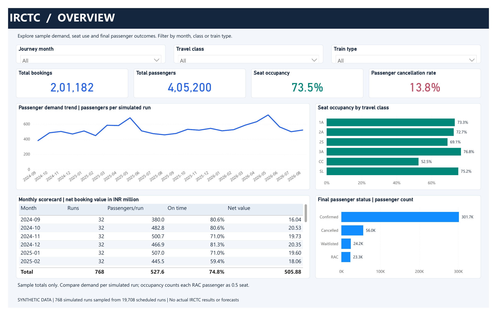
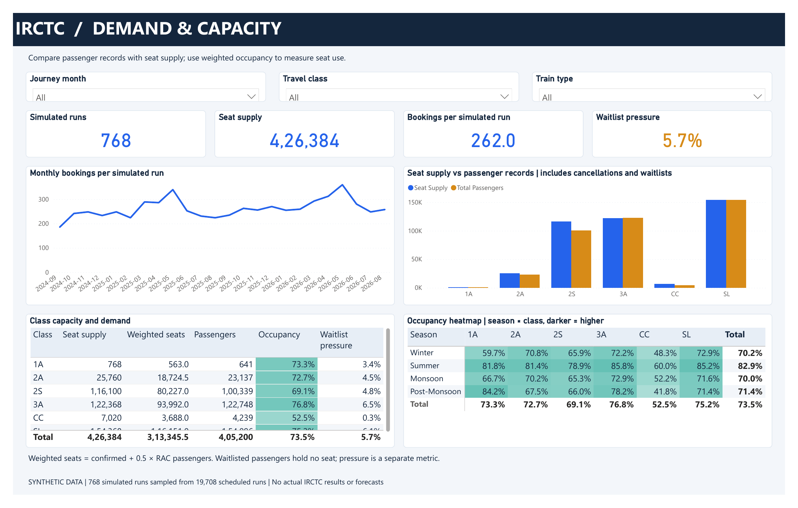
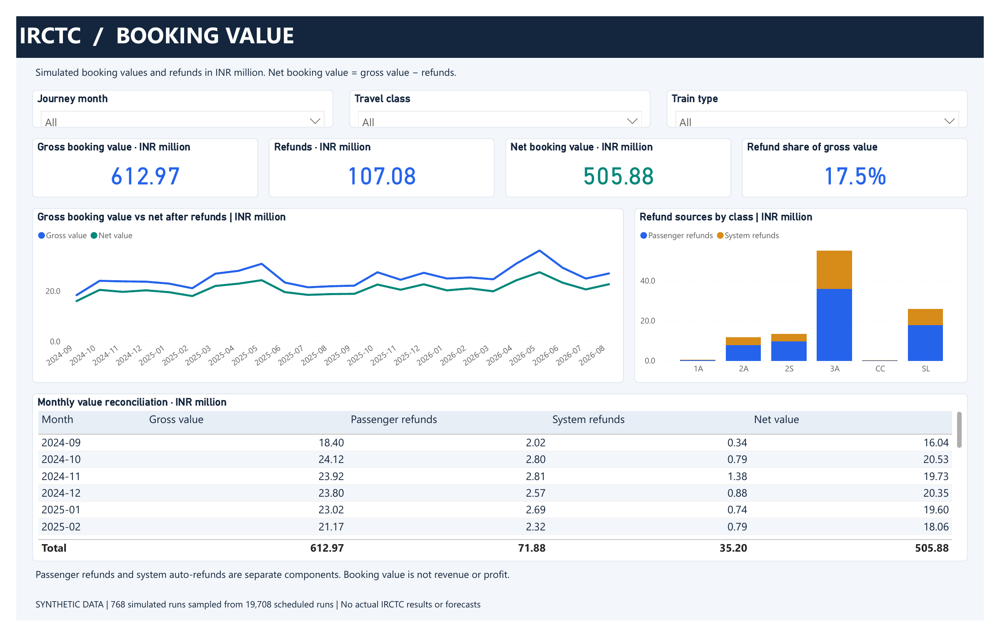
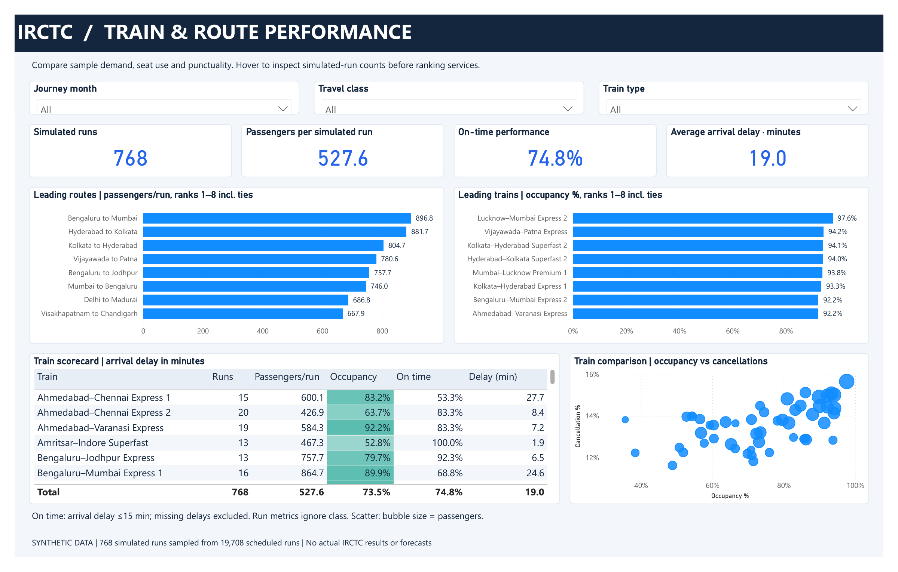
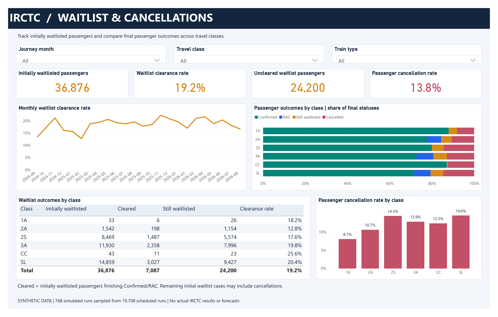
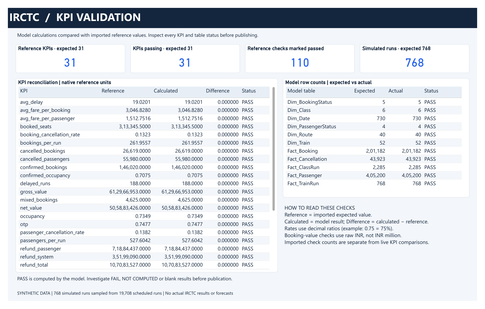

# Power BI portfolio screenshots

Six PNG images rendered directly from the user-provided Power BI PDF export. No chart values, labels or visual content have been retouched. Each image is 2400 × 1530 pixels.

**Synthetic data only:** 768 simulated runs sampled from 19,708 scheduled runs. These are not actual IRCTC results, network-wide statistics or forecasts. Booking values are not revenue or profit.

[Download the original six-page PDF](IRCTC_Portfolio.pdf)

These static exports show the visible portion of scrollable tables. They demonstrate the exported report appearance; they do not prove refresh completion, all interactions or save/reopen behavior. Publication of the editable PBIP/model is a separate deliverable.

## Overview

## Demand and capacity

## Booking value

## Train and route performance

## Waitlist and cancellations

## KPI validation

