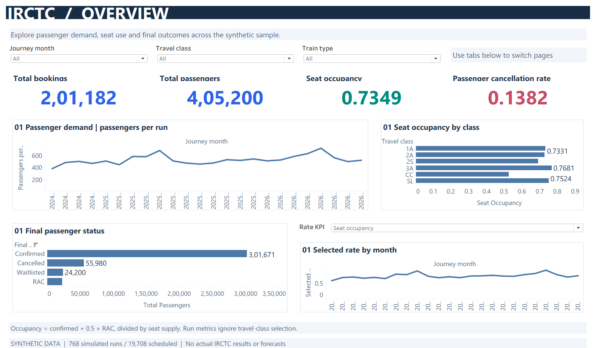
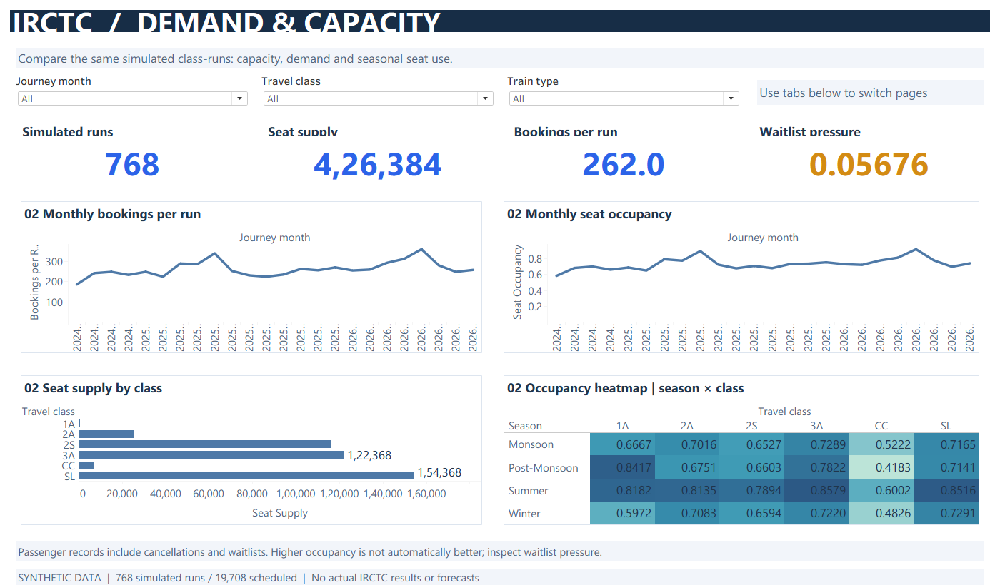
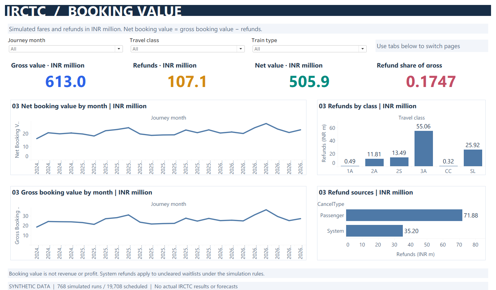
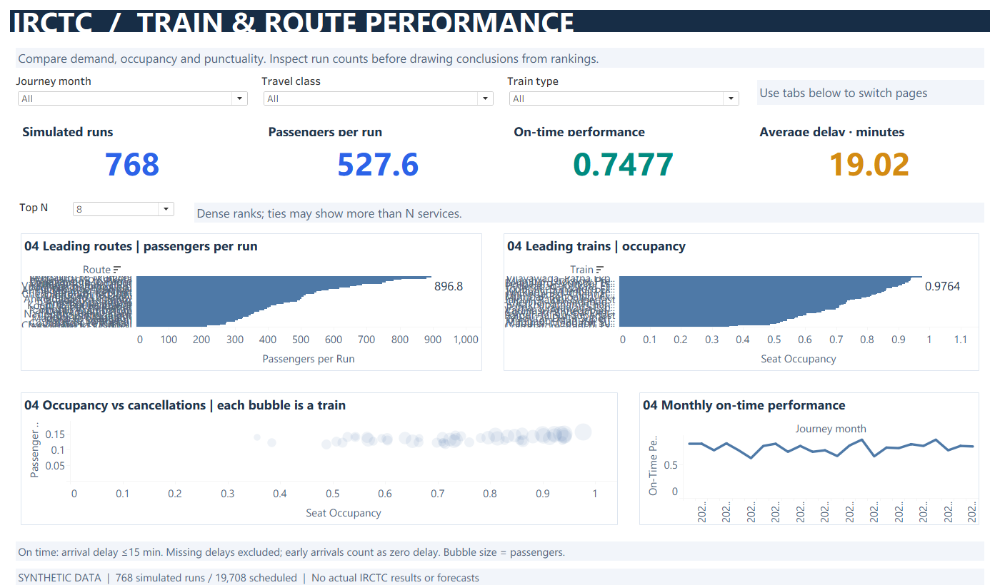
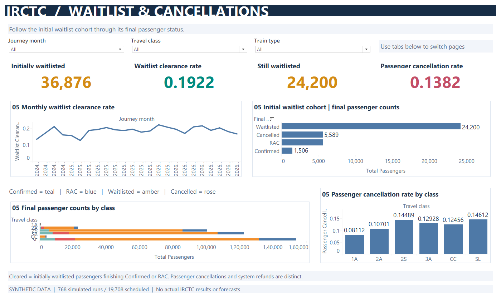
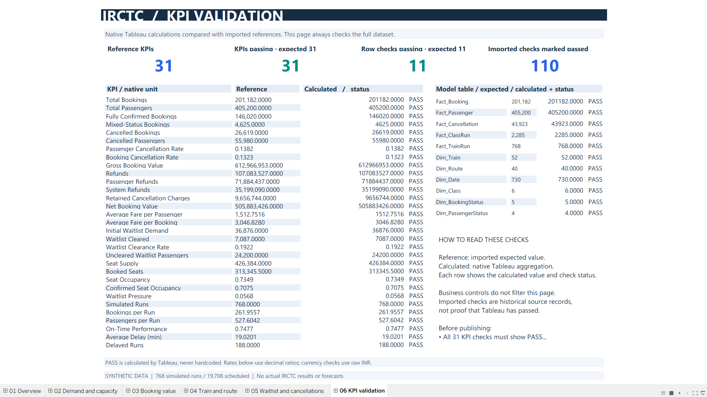

# IRCTC Tableau portfolio

Synthetic data from 768 simulated runs sampled from 19,708 scheduled runs. The validation dashboard compares native Tableau calculations with project references.

### Overview

### Demand and capacity

### Booking value

### Train and route performance

### Waitlist and cancellations

### KPI validation

